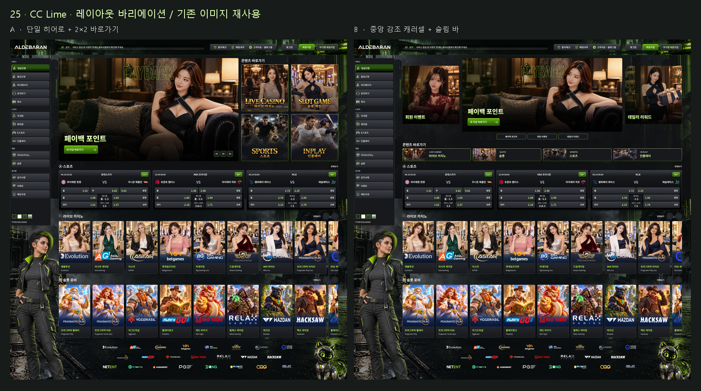

# CC Lime 레이아웃 바리에이션 2종

- 대상 파일: PoUHKHsm9xOYavWBQ7uAGP
- 원본: [CC Lime · 24 기본형 고정 · 1920](https://www.figma.com/design/PoUHKHsm9xOYavWBQ7uAGP?node-id=803-1334)
- 신규 페이지: **25 · CC Lime · 레이아웃 바리에이션 · 1920** (`919:7490`)
- 상태: Figma 디자인 제작 및 프로토타입 전환 검증 완료. 사용자 최종 선택 전. 웹 코드 적용/배포 없음.

## 비교 화면

| 안 | 구성 | 크기 |
|---|---|---|
| [A 단일 히어로 + 2×2 바로가기](https://www.figma.com/design/PoUHKHsm9xOYavWBQ7uAGP?node-id=919-7491) | 왼쪽 대형 배너 1개, 오른쪽 정사각형 바로가기 4개. 01/02/03으로 기존 혜택 이미지 전환 | 히어로 1024×588, 바로가기 각각 268×268 |
| [B 중앙 강조 캐러셀 + 슬림 바](https://www.figma.com/design/PoUHKHsm9xOYavWBQ7uAGP?node-id=920-7490) | 중앙 대형 배너와 좌우 소형 미리보기. 아래에 낮은 가로 바로가기 4개 | 중앙 912×420, 측면 324×332, 바로가기 각각 389.75×72 |

두 전체 화면은 각각 **1920×1941.2**이며 같은 상단 영역 높이 588로 구성했다. 스포츠·라이브 카지노·슬롯·파트너의 시작 위치가 두 안에서 같아 구조만 비교할 수 있다. 메인 간격 16, 타이틀과 콘텐츠 간격 8을 유지했다.

A는 사진을 크게 보여주면서 4개 진입점을 같은 높이에 모으는 방향이다. B는 여러 혜택의 존재를 한눈에 알리고 바로가기를 얇게 정리하는 방향이다. 기존 CC Lime 색상, 헤더/사이드바, 사이버펑크 배경과 캐릭터를 재사용했다.

## 편집과 재사용

페이지 하단의 `P25/CC Lime/Top layout` 컴포넌트 세트(`925:2034`)에 두 레이아웃 마스터를 두었다.

- `Layout=SoloSquare` (`925:1784`)
- `Layout=CenterBars` (`925:1878`)

사진·가독성 오버레이·타이포·버튼·클릭 영역을 각각 별도 레이어로 유지했다. 원본 사진 파일을 수정하지 않았으며 새 이미지를 생성하지 않았다. 새로운 비율에 맞춰 복제본의 이미지 크롭과 텍스트 위치를 조정했다.

전체 화면 상단은 프로토타입의 SCROLL_TO 대상이 실제 프레임을 참조하도록 **편집 프레임**으로 유지했다. 상단 전체가 마스터에 연결된 인스턴스라고 볼 수는 없다. 재사용용 마스터는 같은 페이지에 별도로 보존했고, 최종 프레임과 마스터의 자식 외형 해시가 일치했다. 나머지 인스턴스는 A 87개, B 91개이며 연결이 끊긴 인스턴스는 발견되지 않았다.

## 프로토타입

- [A 미리보기](https://www.figma.com/proto/PoUHKHsm9xOYavWBQ7uAGP?node-id=919-7491&page-id=919%3A7490&starting-point-node-id=919%3A7491&scaling=scale-down-width)
- [B 미리보기](https://www.figma.com/proto/PoUHKHsm9xOYavWBQ7uAGP?node-id=920-7490&page-id=919%3A7490&starting-point-node-id=920%3A7490&scaling=scale-down-width)

A는 번호 버튼, B는 혜택 이름 버튼으로 이동한다. B의 좌우 미리보기에도 해당 중앙 위치로 가는 이동 대상을 연결했다. 두 안 모두 가로 스크롤 프레임을 사용한다. B는 가로 트랙의 세 중앙 정렬 위치를 설정한 프로토타입이며, 무한 순환/자동 재생이 구현되었다고 판단하지 않는다.

브라우저 Figma 미리보기에서 확인한 동작:

- A: 페이백 → 리워드 → 회원 이벤트 → 페이백.
- B: 페이백 → 회원 이벤트 → 리워드 → 페이백.
- 전환 중 주변 콘텐츠와 헤더/사이드바는 유지됨.
- 번호 버튼은 고정된 활성 상태를 남기지 않는 동일한 이동 컨트롤 스타일로 정리.

처음에는 컴포넌트 인스턴스 내부의 마스터 대상 SCROLL_TO가 동작하지 않았다. 전체 비교 화면의 상단만 편집 프레임으로 전환하고 실제 목적지 ID에 재연결한 뒤 위 이동을 확인했다. 개별 좌우 미리보기 클릭과 드래그 입력은 별도 실제 조작 검증을 하지 않았으며, 대상 존재와 가로 스크롤 속성만 정적으로 확인했다. 실제 사이트 링크/업무 기능은 추가하지 않았다.

## 검증과 보존

- `source-verification.json`: 기존 12개 전체 화면 + 관련 마스터 44개, 총 56개 내용/좌표 해시 변화 없음.
- 원본 CC Lime 전체 해시: `ca4b3723`, 원본 인스턴스 94개 보존.
- `final-verification.json`: 두 안의 실프레임 ID, 연결 인스턴스, 원본 이미지 재사용, 이동 대상 및 하위 콘텐츠 해시.
- 각 화면의 고유 이미지 해시 100개 모두 원본에 포함. 새 이미지 해시 0개.
- 스포츠·라이브·슬롯·파트너 하위 트리는 복제 이후 변경되지 않음. 상단 확장에 따른 외부 y좌표 이동만 있음.
- 전체 1920px 렌더에서 얼굴/선물, 타이틀, CTA, 바로가기, 하단 전체 구성을 시각 확인했다.
- `qa/`에 전체 렌더와 브라우저 전환 증거를 보관했다. 프로토타입 브라우저 캡처는 뷰포트 일부 화면이며, 전체 레이아웃 검수는 전체 렌더로 수행했다.
- 실패 후 원자적으로 롤백된 스크립트: 03, 04, 09. 재실행용 성공 경로는 00→01→02→05→06→07→08→10→11→12이며, 기존 결과가 있으므로 그대로 재실행하지 않는다.

기존 페이지24, 기존 컴포넌트 마스터, 원본 사진/생성 이미지, 사이트 코드·로컬 서버·배포는 변경하지 않았다. 실제 웹 반응형 동작은 이번 Figma 시안 범위에서 검증하지 않았다.
