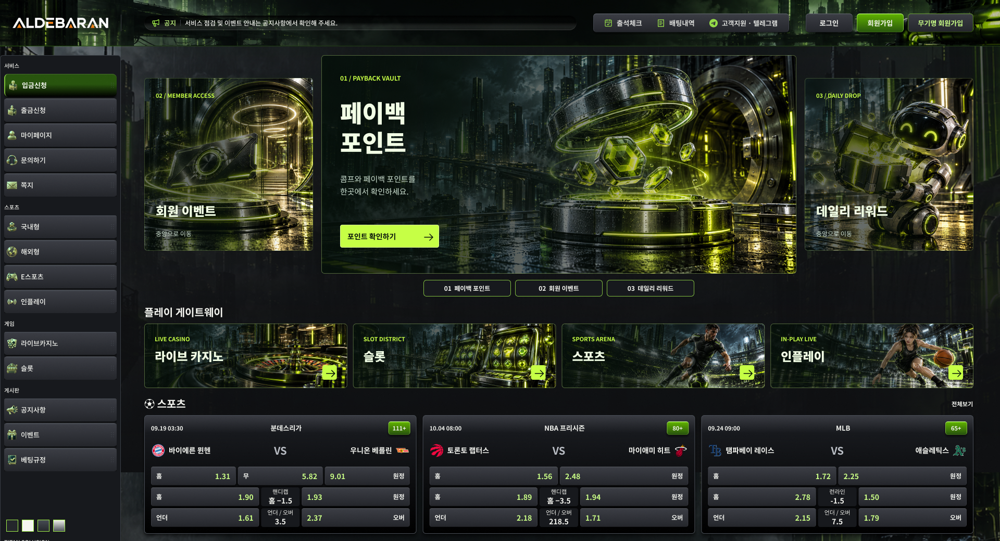

# CC Lime · B2 Neon District

[새 전체 화면 열기](https://www.figma.com/design/PoUHKHsm9xOYavWBQ7uAGP?node-id=937-1767)

- Figma 페이지: **25 · CC Lime · 레이아웃 바리에이션 · 1920**
- 원본 B: `920:7490`, 신규 B2: `937:1767`, 상단 편집 프레임: `937:1783`
- 화면: 1920×1993.2, 중앙 강조 캐러셀과 전면 이미지 바로가기 4개.
- 상태: 생성·기술/시각 검수·Figma 시안 적용 완료. 새 결과에 대한 사용자 최종 승인과 실제 웹 채택/배포는 별도.

## 새 구성

기존 B를 같은 페이지 오른쪽에 복제했다. 중앙 912×420 배너와 좌우 324×332 미리보기 구조를 유지하고, 큰 한글 제목·짧은 설명·라임 CTA로 정보 위계를 다시 구성했다.

| 목적 | 생성 장면 | 문구 방향 |
|---|---|---|
| 페이백 포인트 | 네온 도시의 포인트 보관소와 빛나는 토큰 | 포인트 확인 / 기존 콤프·페이백 안내 |
| 회원 이벤트 | 회원 초대 패스와 미래형 입구 | 진행 중인 혜택·참여 조건 확인 |
| 데일리 리워드 | 선물 상자를 든 서비스 로봇 | 기존 출석 체크와 보상 안내 |

바로가기는 389.75×124 네 개의 전면 이미지 버튼이다. 라이브 카지노(룰렛), 슬롯(머신), 스포츠(축구), 인플레이(농구)를 서로 다른 장면으로 구별했다. 이미지가 버튼 전체를 채우고, 제목·영문 구분명·라임 화살표는 별도 레이어다. 소형 이미지와 단색 텍스트 영역을 나누던 기존 구조를 없앴다.

상단 높이는 588→640으로 52px 증가했다. 하단 스포츠·카지노·슬롯·파트너는 같은 내부 구성으로 아래로 이동했다. 메인 간격 16과 타이틀-콘텐츠 간격 8을 유지했다. 사이트 로고/상단 내비게이션·사이드바·기존 배경/캐릭터·하위 상품 이미지는 그대로다.

## 편집

- 이미지: `Image · <asset-key> · generated / full bleed`
- 오버레이: `Overlay · contrast / separate layer`
- 텍스트: `Title / editable`, `Description / editable`, `Eyebrow / editable`
- CTA/진입 표시와 클릭 영역은 이미지에서 분리했다.
- 기존 화살표 벡터 형태를 유지하고 새 복제본의 선 색만 짙은 색으로 보정했다.
- 상단은 편집 가능한 프레임이며, 기존 A/B의 컴포넌트 세트에 새 마스터를 추가하거나 기존 마스터를 바꾸지 않았다.
- 전체 화면의 연결 인스턴스 91개, 끊긴 연결 0개.
- 실제 웹 라우트/업무 기능은 추가하지 않았다.

## 이미지와 생성 이력

내장 `image_gen` 사용. 독립 이미지 7개를 각각 생성했다. 콜라주를 잘라 여러 결과로 취급하지 않았다.

- 총 시도 8회, 성공 7회, 실패 1회, 건너뜀 0회.
- 첫 회원 이벤트 인물 장면은 도구의 출력 안전 검사로 거절되었고 파일이 생성되지 않았다. 인물이 없는 초대 패스/입구 장면으로 바꿔 한 번 다시 생성했다.
- 성공 출력 7개는 최종 폴더 `results/`로 이동했다. 이동 전후 SHA-256 일치, PNG 형식, 실제 크기와 읽기 가능 여부를 검증했다.
- 배너 3개: 1850 또는 1851×850, 바로가기 4개: 2172×724. 사용자가 정확한 생성 픽셀 치수를 지정한 작업은 아니며, Figma 슬롯에 맞는 크롭을 적용했다.
- `prompts/`에 실제 프롬프트와 실패한 첫 시도 프롬프트를 보관했다.
- 참조 1은 현재 B 화면(세계관·사용 맥락), 참조 2는 첫 포인트 이미지(재질·조명)다. 기존 인물 사진/정체성/글자는 복제 대상으로 삼지 않았다.
- 생성 이미지에서 글자를 구워 넣지 않았다. 혜택 금액·기간·지급 조건을 새로 만들지 않았다.
- `run.json`, `asset-inventory.json`, `placements.json`에 원본 경로, 저장 경로, 해시, 업로드 및 배치 대응을 기록했다.
- 이전 생성 이미지와 `D:/WebDL`은 건드리지 않았다.

## 확인한 범위

- Figma 전체 1920px 렌더와 실제 크기 바로가기에서 제목·주체·크롭·대비를 확인했다.
- A/B 원본과 기존 상단 컴포넌트 세트의 내용/좌표 해시가 작업 전후 같았다.
- 새 화면 하위 네 영역의 내부 해시가 복제 직후와 같았다.
- 새 이미지 해시 7개가 11개 배치 슬롯에 연결됨(혜택 미리보기는 같은 이미지를 재사용).
- 바로가기 4개 모두 이미지 레이어가 카드 전체 크기와 일치한다.
- 캐러셀 이동 7개 모두 새 복제본 내부의 실제 대상에 연결되어 있다.
- 브라우저 프로토타입에서 페이백→회원 이벤트→데일리 리워드 전환과, 좌측 페이백 미리보기 클릭으로 중앙 복귀하는 동작을 확인했다.

[프로토타입 열기](https://www.figma.com/proto/PoUHKHsm9xOYavWBQ7uAGP?node-id=937-1767&page-id=919%3A7490&starting-point-node-id=937%3A1767&scaling=scale-down-width)

드래그 입력, 무한 순환·자동 재생, 실제 웹 반응형 동작과 배포는 검증/구현 범위에 포함하지 않았다.
