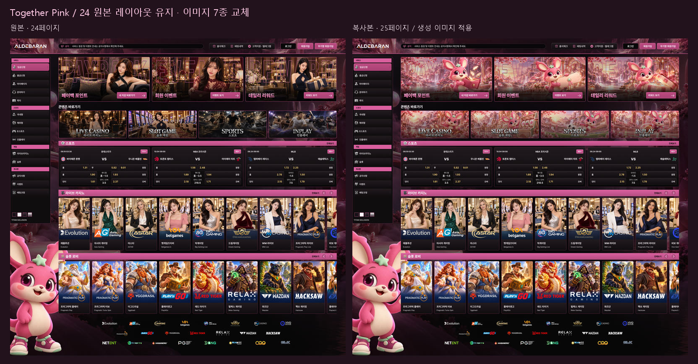

# Together Pink · 고정 레이아웃 · 생성 이미지 적용

[25페이지 복사본 열기](https://www.figma.com/design/PoUHKHsm9xOYavWBQ7uAGP?node-id=949-2268)

- 원본: 페이지24 `850:3637`, **Together Pink · 24 기본형 고정 · 1920**
- 복사본: 페이지25 `949:2268`, **Together Pink · 24 레이아웃 고정 · 생성 이미지 · 1920**
- 화면 크기: 원본과 같은 1920×1819.2. 새 위치 x6460, y220.
- 상태: Figma 비교 시안 적용 및 기술·시각 검수 완료. 사용자 최종 승인/실제 웹 채택/배포는 별도.

## 적용한 이미지

기존 페이지의 원작 토끼 마스코트와 핑크 판타지 배경을 실제 참조로 사용했다. 기존 인물 사진·로고·UI는 이미지 생성의 복제 대상으로 삼지 않았다.

| 역할 | 새 이미지 장면 | 기존 슬롯 |
|---|---|---|
| 페이백 포인트 | 토끼, 지갑, 무표기 토큰 | 약522.67×256 |
| 회원 이벤트 | 토끼와 초대 패스 | 약522.67×256 |
| 데일리 리워드 | 토끼와 열린 선물 | 약522.67×256 |
| 라이브 카지노 | 토끼 호스트와 룰렛 | 389.75×158 |
| 슬롯 | 토끼와 핑크 슬롯 머신 | 389.75×158 |
| 스포츠 | 축구하는 토끼 | 389.75×158 |
| 인플레이 | 농구하는 토끼 | 389.75×158 |

총 생성 7회, 성공 7개, 실패/건너뜀 0개. 각 호출은 독립 이미지 하나였으며 콜라주를 나누지 않았다. `results/`는 생성 성공 원본, `prompts/`는 실제 프롬프트, `run.json`은 경로·해시·참조·검수 상태다. 기존 이미지나 이전 생성물은 덮어쓰지 않았다.

## 유지한 레이아웃과 편집 구조

- 세 배너의 가로 배열, 네 바로가기 배열, 카드 크기·좌표·패딩·간격을 유지했다.
- 모든 텍스트 내용과 타이포 속성, 기존 버튼·타이틀 이미지·아이콘 모양·테두리 표현을 유지했다.
- 헤더, 사이드바, 큰 배경/마스코트, 스포츠·카지노·슬롯·파트너 영역도 유지했다.
- 큰 영문 윤곽 글자는 원본처럼 캐릭터 뒤에 배치했다. 래스터 이미지와 원본 타이포는 분리되어 있다.
- 전경 복원 사진을 새 사진과 동일한 크롭으로 바꾸고, 원본 인물 윤곽은 토끼/소품에 맞춘 편집 가능한 네이티브 벡터 마스크로 교체했다.
- 원본 마스터 수정 없이 마스크를 바꾸기 위해 새 복사본의 배너 인스턴스 3개만 편집 프레임으로 전환했다. 나머지 인스턴스 91개는 연결을 유지했다.
- 바로가기 4개는 기존 인스턴스 연결을 유지하면서 Artwork 이미지 채움만 덮어썼다. 기존 타이틀 이미지를 그대로 유지했다.
- 마스크의 외곽 형상은 이미지에 맞춰 달라졌으며, 마스크 컨테이너의 0,0 / 약522.67×256 크기는 유지했다.
- 임시 업로드 대상은 이미지 해시 연결 후 제거했다.

## 검증

- `verification.json`: 원본 Together Pink 전체 해시 `18aed130` 일치.
- 마스크 내부 윤곽 형상만 비교에서 제외한 전체 레이아웃 해시가 원본/복사본 모두 `8ede3586`으로 일치했다. 전경 윤곽은 이미지 교체에 필요한 의도된 차이다.
- 텍스트/타이포 스냅샷 일치, 하위 네 영역의 내부 해시 일치.
- 새 이미지 7개가 실제로 사용되며, 배너 전경 복원까지 포함해 이미지 채움 10곳을 갱신했다.
- 연결 인스턴스 91개, 끊긴 연결 0개. 임시 업로드 프레임 잔여 0개.
- 1920px 전체 렌더와 약1592px 실제 크기 배너/바로가기 묶음에서 제목 가독성, 캐릭터 얼굴·소품, 이미지 크롭과 마스크를 확인했다.
- 생성 파일 7개 모두 PNG, 읽기 가능, 이동 전후 SHA-256 일치를 확인했다.
- 웹 코드·서버·배포·저장 데이터는 변경하지 않았다. 실제 웹 반응형 동작은 검증하지 않았다.

## 기존 페이지25의 별도 차이 기록

작업 중 기존 CC Lime B2(`937:1767`)의 해시가 `18d4631d`에서 `90d177b2`로 바뀐 것을 감지했다. 이번 쓰기 작업의 대상 ID에는 B2 및 그 하위 노드가 없다. 현재 크기·좌표·본문·상단 구조는 이전 기록과 같았으며, 이전 저장 렌더와 비교한 픽셀 차이는 바로가기 화살표 네 곳 주변(y709–725)에 국한됐다. 원인을 확인할 수 없어 사용자의 현재 작업을 임의로 복원하거나 덮어쓰지 않았다. 이 항목을 '보존 해시 일치'로 보고하지 않는다. A, B 및 기존 상단 컴포넌트 세트의 해시는 작업 시작 기준과 일치했다.

## 실행 오류의 복구

실패한 두 복제 호출은 도구의 원자적 롤백으로 커밋되지 않았다. 실제 레이블 폰트를 로드하고 중복 ID 맵 반환을 줄여 복제했다. 업로드 도구가 가상 인스턴스 자식 ID를 받지 않아 임시 실제 노드를 거쳐 업로드한 뒤 인스턴스 이미지 채움에 해시를 적용했다. 실패를 생성 이미지 실패로 세지 않았다.

